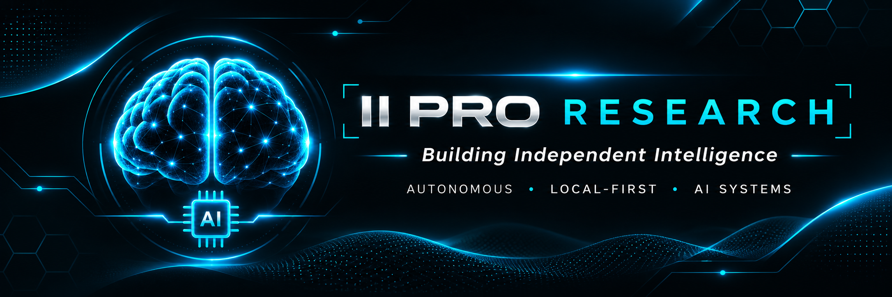

# Building Independent Intelligence

**AUTONOMOUS · ADAPTIVE · LOCAL-FIRST**

---

## ◈ Our Mission

II PRO Research is an independent initiative dedicated to developing autonomous artificial intelligence systems.

Our mission is to build intelligence capable of solving real-world engineering problems, using tools, learning from verified experience and progressively improving its capabilities while reducing dependence on cloud providers.

## ◈ Flagship Project — II PRO Studio

An experimental hybrid AI platform built around a unified, human-governed architecture.

| Component | Purpose |
| :--- | :--- |
| Core | Central orchestration and execution control |
| Local Engine | Local artificial intelligence |
| Agent Team | Collaborative engineering intelligence |
| Tool Broker | Controlled tool execution |
| Verified Memory | Persistent, validated knowledge |
| Skill Engine | Engineering skill acquisition |
| School | Learning and independent evaluation |
| Shadow Learning | Knowledge transfer from AI mentors |
| Evolution Engine | Controlled system improvement |
| Continuity Engine | Account-independent project memory |
| Telegram Gateway | Remote interaction and management |

## ◈ Technology Stack

## ◈ Research Roadmap

- [x] Unified Core architecture
- [x] Local model integration
- [x] Hybrid AI agent collaboration
- [x] Controlled tool execution
- [x] Verified observation transfer
- [ ] Full autonomous engineering workflow
- [ ] Persistent project continuity
- [ ] Telegram integration
- [ ] Experience-driven skill acquisition
- [ ] Validated self-improvement
- [ ] Local-first autonomous intelligence
- [ ] Distributed intelligence

## ◈ Engineering Principles

- One unified architecture.
- Evidence over assumptions.
- Security by design.
- Human-governed autonomy.
- Reproducible experiments.
- Continuous, measurable improvement.
- Independence from individual AI providers.

---

### Building intelligence, not just another chatbot.

**II PRO RESEARCH**

*Independent AI Research & Development*

EST. 2026

